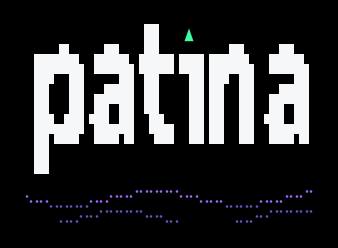
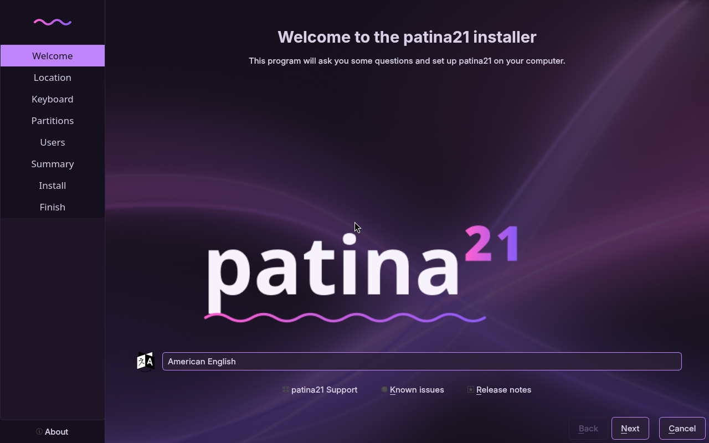
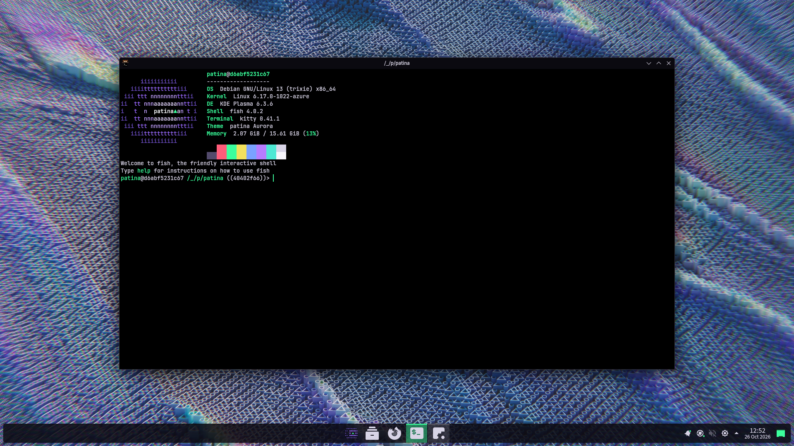
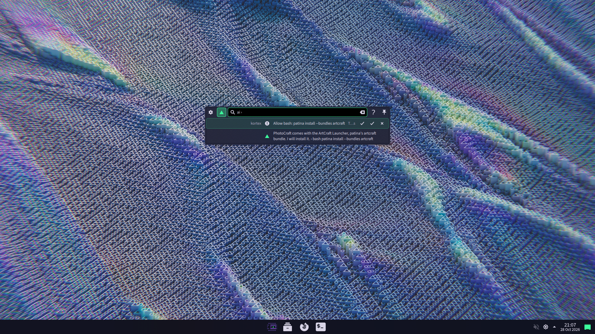
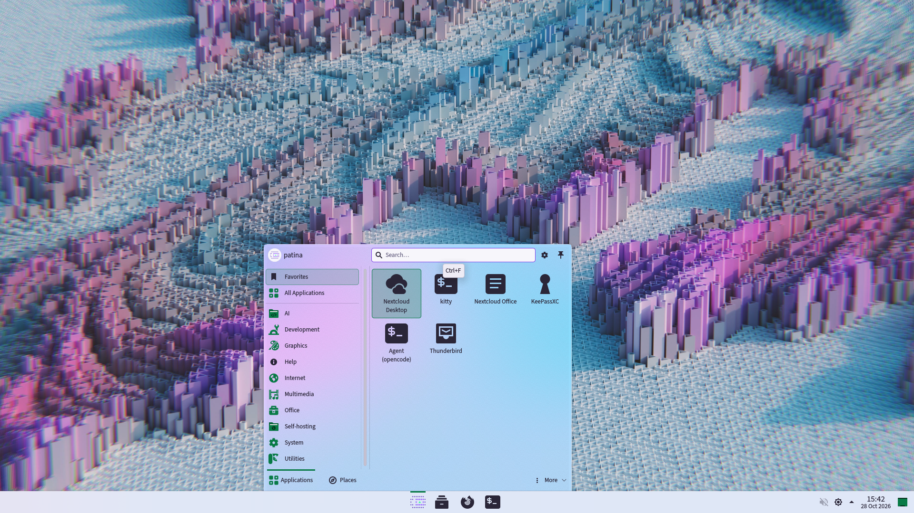

<h1 align="center">
  <picture>
    <source media="(prefers-color-scheme: dark)" srcset="branding/export/wordmark-blocks.svg">
    
  </picture>
</h1>

<p align="center">
  <a href="https://github.com/patina-os/patina/actions/workflows/smoke.yml"></a>
  <a href="https://github.com/patina-os/patina/actions/workflows/lint.yml"></a>
  <a href="LICENSE"></a>
  <a href="https://www.debian.org/releases/trixie/"></a>
</p>

<p align="center">
  Themes, consistency across apps, curated defaults, agent CLIs and a free-software,
  EU-sovereign app stack on top of Debian stable with Plasma. Not a distribution.
</p>

**Status: alpha, for testers.** `patina install` installs the app stack, the AI agent
and the system tuning on Debian 13 and renders the default theme, aurora, into Plasma's
configuration (checked in CI containers on x86_64 and aarch64, not yet on a real
desktop); the branded install is still to come. [Testing the alpha](#testing-the-alpha) says how to
help; see the [roadmap](docs/roadmap.md).

## The agent in the command palette

<p align="center">
  
</p>

Meta+Space, `ai` and what you want: [kortex](https://github.com/patina-os/kortex), patina's
KRunner runner, hands the request to the AI agent and shows the answer right in the
command palette, and every action the agent wants to take as its own line with Allow
once, Always and Deny. Nothing runs before you choose. Above, `ai install photocraft`:
the agent knows PhotoCraft comes with the ArtCraft Launcher, patina's `artcraft`
bundle, asks before it runs `patina install --bundles artcraft`, and asks again before
it opens the launcher, where you pick PhotoCraft. The agent is
[opencode](https://opencode.ai), free software, with a model on your machine by default;
[The AI agent](#the-ai-agent) says more.

<sub>A replay of a real run of kortex 0.1.0 with opencode and a scripted model; how it
is made is in kortex's [`docs/demo/`](https://github.com/patina-os/kortex/tree/main/docs/demo).</sub>

## Screenshots

All taken by CI, never edited (`iso/README.md` says how). The installer's welcome page,
as the live image's boot test captures it (amd64, QEMU, Calamares as Debian 13 ships it,
branded through data), with the AI agent's page among the steps:



The finished desktop, as the `desktop` workflow captures it (amd64, a Plasma X11
session on a virtual framebuffer after `patina install`): aurora, the default theme,
with its wallpaper, the centred bar of one-colour icons and slightly see-through
windows: kitty split in two, the fastfetch greeting beside btop.



The command palette in the same session, in the middle of the empty desktop:
`ai install photocraft`, kortex's answer through a real `opencode serve`, and the
agent's request to run `patina install --bundles artcraft`, waiting for Allow once,
Always or Deny. The model is kortex's scripted demo model, since CI has none to run.



The start menu in aurora's light mode (`patina theme mode light`), over its own
DeepMind wallpaper: the patina mark as its button, the AI and self-hosting folders
first, then the favourites.



## What it is

patina takes a stock Debian with Plasma and finishes it: one consistent theme across
Plasma, terminal and editors, sane defaults, the apps a privacy-minded developer in the
EU wants, an AI agent that answers, changes settings when you say yes, writes code and
works on your servers (opencode, with a model on your machine or from a cloud provider
you pick), right in the command palette through kortex, and the agent tools (Claude Code, Codex CLI, opencode, Claude Desktop,
Ollama for local models) installed the way their upstreams intend.

It is inspired by [Omarchy](https://omarchy.org): the polish, the themes, the quick
branded boot-to-finished-desktop install, and the `git pull` plus migrations update
model. It does not copy Omarchy's tiling-first UX, patched kernel or own package
repository.

## What it is not

- not a fork of Debian and not a distribution: every package comes from Debian's
  archive, Flathub or an upstream installer
- not a kernel, not a package repository, not rebuilt packages: security is the base's job
- not Hyprland-first: Plasma first; Hyprland may become an add-on later
- not for Apple Silicon

## The stance

1. Free software only. No snap, no proprietary defaults, no US cloud services as defaults.
   Proprietary agent tools exist as an opt-in bundle, never preselected. The AI agent
   is free software; its default model runs on your machine, and a cloud provider is
   your choice, European ones first.
2. Own the UI, own nothing that gets CVEs.
3. Data over code: themes, keybindings and package lists are data files; scripts stay thin.
4. Every design choice must reduce the work for a one-person, part-time maintainer.

## Install

Two paths, one layer. If they ever diverge, Path A wins.

| Path | What you do | Status |
|---|---|---|
| A: on stock Debian | Install Debian 13 with Plasma, `git clone` this repository, run `patina install` (it asks the theme and the app bundles on a terminal; flags or `--unattended` skip the questions) | alpha (`v0.1.0-alpha.1`): installs the app stack, the system tuning and the theme, checked in CI containers; testers run it on real desktops |
| B: the patina image | Boot a small live image, answer the installer (disk, user, locale), get the finished desktop. Plasma and the base are downloaded from Debian's mirrors during the install; first boot runs Path A | pre-alpha: the image builds and boots to the installer in CI (x86_64 and aarch64), not handed out yet; the first boot waits for Path A |

```sh
sudo apt install git curl
git clone https://github.com/patina-os/patina.git ~/.local/share/patina
~/.local/share/patina/bin/patina install            # the default bundles: base, desktop
~/.local/share/patina/bin/patina install --bundles desktop,artcraft   # plus ArtCraft
~/.local/share/patina/bin/patina install --all      # every opt-in bundle, agent tools included
```

`patina install --list` shows the bundles, `patina doctor` checks the result,
`patina theme list` and `patina theme set <name>` switch the theme (`PATINA_THEME=<name>`
picks one for the install), and `patina update` runs `git pull` and then any pending
migrations. Put `~/.local/bin` on
your PATH and link `patina` there (`ln -s ~/.local/share/patina/bin/patina
~/.local/bin/patina`).

## Testing the alpha

`v0.1.0-alpha.1` is the first release, for people willing to try patina on a fresh
Debian 13 with Plasma and report what they see. It is Path A only; the image is not
handed out yet. Everything has run in CI containers and a headless Plasma session, never
on a real desktop, so expect rough edges, and use a VM with a snapshot or a machine you
can reinstall.

1. Follow [docs/vm-run.md](docs/vm-run.md): the VM, Debian 13, then `patina install`
   twice, the reboot, the apps and the look, ticking each check. The agents bundle
   (step 8) is optional.
2. Open a [test report](https://github.com/patina-os/patina/issues/new?template=test-report.yml)
   with what passed and what did not, `patina version` and the output of
   `patina doctor`, failing or not. One report per run.
3. `patina update` brings fixes as they land on `main`; a second run on a later version
   is welcome.

What the alpha does not cover yet: the live image (Path B), aarch64 hardware beyond CI
(a Raspberry Pi 4 or a Snapdragon X Elite laptop is welcome, see
[docs/hardware.md](docs/hardware.md)), and an update from one release to the next.

## Supported bases

| Base | Architectures | Status |
|---|---|---|
| Debian 13 (trixie) | x86_64, aarch64 | reference base, alpha |
| Debian 14 | x86_64, aarch64 | follows when it becomes stable |
| openSUSE Tumbleweed | | possible later; backend file kept, untested |
| Fedora | | possible later, not a priority; backend file kept, untested |
| Arch Linux | | possible later, not a priority; backend file kept, untested |
| Ubuntu, CachyOS | | not planned |

The layer itself has no architecture. aarch64 is a first-class target from day one; see
[docs/hardware.md](docs/hardware.md) for what has been tested.

## The look

One theme from the boot menu to the desktop, from one data file: the live image's boot
menu, the installer, the login screen, the Plasma splash, Plasma itself, Konsole, kitty,
GTK and Flatpak apps, the install questions, the terminal greeting and the tools in the
terminal (btop, neovim, bat, fzf, lazygit, eza, starship) all take their colours from
the theme's palette; the words are set in Source Sans 3, the details in
JetBrains Mono, the wordmark in Sora. The default theme is aurora, made for OLED
screens: true black, neon green as the accent and violet as the second colour, a
Google DeepMind visualisation from Pexels as the wallpaper (a white one of the same
series in the light mode) and a contour map that glows green to violet as the second.
Every app's icon is a monochrome glyph in one colour, the folders are green, and the
start menu (the patina mark, AI and self-hosting first)
and the other popups carry a slight grain. It is
dark by default; `patina theme mode light` switches it to its light palette and
`patina theme mode dark` back. The mark is text, a summit shaded with the letters of
patina in violet with a green survey point, so the terminal and the screens show the
same one. datum (graphite, ice and coral around a contour map) and amethyst, the first
theme, a purple palette with two abstract wallpapers, stay as options (`patina theme
set datum`).
Meta plus
one key opens the terminal (Return), the search (Space), the browser (B), the files (E)
and the AI agent in its own terminal profile (A);
Meta+K shows all of them, and Plasma's own, at a glance (`patina keys`). Themes shared
in a repository of their own install with `patina theme install <git-url>`, as data
only. The
Plasma-side speed settings CachyOS is known for (lowest compositor latency, shorter
animations, file-name-only indexing, the Wayland session) are curated defaults. So is the
shape of the desktop: one bar with the launcher and the task icons in the centre, as on
Windows 11, and new windows that open centred at the same size. The first `patina
install` and every fresh login get the bar; after that your panels are yours, and
`patina theme set <name> --layout` brings the bar back.

## The app stack

Nextcloud client, Thunderbird, Element, KeePassXC, Euro-Office (the European, AGPL fork of
ONLYOFFICE), Firefox ESR (telemetry, Pocket and sponsored content off), Tauon for music,
Haruna for video, Gwenview for images, Okular for PDFs, kitty as the terminal, a
developer kit (fish, starship, bat, eza, fzf, ripgrep, lazygit, btop, zoxide, atuin,
git-delta, neovim, fastfetch) and the Zed editor, plus the agent tools above. Gaming
is not a focus.

Opt-in, as an external package: the `artcraft` bundle (`patina install --bundles
artcraft`) brings the launcher of the [ArtCraft](https://craftingapps.org) suite, free
counterparts of Photoshop, Illustrator, Word, Excel, PowerPoint, Acrobat and seven
more, still alpha. Neither Debian nor Flathub carries it yet, so the ArtCraft Launcher
comes as its upstream's AppImage, pinned in `manifest/upstream.yaml`; you pick the apps
in it, and it installs and updates them and itself, outside apt. It sits among the
start menu's favourites, and moves to Debian's archive or Flathub as soon as one of
them carries it. Euro-Office stays the office suite of the default stack. Everything comes from Debian's archive except what it does
not carry: GUI apps we do not want to track come from Flathub, agent tools from their
upstream installers (npm, uv, Anthropic's own apt repository for Claude Desktop),
Euro-Office from Nextcloud's signed apt repository until Flathub carries it, and the
ArtCraft Launcher from its release. Ollama is the local backend the agent tools point at.

## The AI agent

`patina install` (and the installer's AI page) asks one question: an AI agent on this
computer, one from a cloud provider, or none. Both agents are
[opencode](https://opencode.ai), free software:

- **local** (the default): Ollama runs the model on your machine. Setup offers the
  models of `ai.local.models` in `defaults/settings.yaml` that fit your memory and
  recommends one: NVIDIA's Nemotron 3.5 Bolt E4B, made for agents, from 16 GB, and
  Mistral's Ministral 3 3B below that. Ministral 3 8B and 14B and Qwen 3.5 4B and 9B
  are the others. Nothing leaves the computer.
- **cloud**: a provider you pick, Mistral and other European providers first, then
  Anthropic and OpenAI. You log in with `opencode auth login`; the key stays in
  opencode's own login, patina never sees it.
- **none**: no agent. `patina install` asks again whenever you run it.

Meta+A opens it. It reads freely, and asks before anything that changes a file, runs a
command or reaches a server (`defaults/apps.yaml`); `defaults/agent.md` tells it how
this machine is put together and how to change it the patina way. In the command
palette (Meta+Space), type `ai` and your request: [kortex](https://github.com/patina-os/kortex),
a KRunner runner in a repository of its own (so it also serves other Plasma desktops),
shows the answer there and every action the agent wants to take with Allow once,
Always and Deny, as the animation at the top shows. `ai` alone lists the recent
conversations, `ai ›` shows the current one, and Open in terminal continues a
conversation in opencode for longer work. Both AI answers install it, from its tagged
release.

## FAQ

**Is this a new distribution?** No. It is a layer on Debian and a live image that only
automates installing that layer. There is no patina kernel, package repository or
rebuilt package, and there never will be.

**Is it Omarchy for KDE?** It borrows Omarchy's polish, quick branded install and update
model, not its tiling UX, kernel or package repository. Themes are stored as
desktop-agnostic data, so a Hyprland rendering could be added later without touching them.

**Why Debian?** The strictest free-software archive of the large bases, the broadest
arm64 support, a two-year stable cycle that keeps maintenance low, and the ecosystem:
third-party installers, vendor packages and manuals assume apt. Debian 13 ships Plasma 6.

**Wasn't this on openSUSE?** It started there, and switched before anything shipped.
openSUSE has the better Plasma polish and the Open Build Service; Debian has the
ecosystem users actually meet. The package manifest is base-agnostic, so the openSUSE
backend stays as data for a possible later flavour.

**Is it fast like CachyOS?** It copies what makes CachyOS feel fast and is configuration:
zram, I/O schedulers, memory and systemd settings, a lean boot, low-latency Plasma
defaults. It does not copy the custom kernel or the rebuilt packages, because patina
owns nothing that gets CVEs.

**Why Plasma?** The most complete free desktop, and it already handles the cross-app
consistency (GTK, Flatpak portals) a layer would otherwise have to build.

**Does it run on ARM?** It is meant to. Phase 1 runs the bootstrap in an aarch64 container
in CI; real hardware starts with the Raspberry Pi 4 and continues with ARM laptops as they
gain Debian kernel support. There is never a separate ARM edition.

**Can I use it on Fedora or openSUSE?** Not yet. The package manifest is base-agnostic by
design, but other backends come only after both install paths are stable on Debian.

## Credits

patina owns the polish; nearly everything under it is the work of other people, and we
are grateful for it. Thank you:

- **Debian** and its developers, for the base and nearly every package, and **KDE**,
  for Plasma and its apps.
- The apps: Nextcloud; Euro-Office (IONOS, Nextcloud and their European partners) and
  ONLYOFFICE, which it is built on; Mozilla's Firefox and Thunderbird; Element;
  KeePassXC; kitty; Zed; Tauon; ArtCraft; and the terminal's tools: fish, starship,
  bat, eza, fzf, ripgrep, lazygit, btop, zoxide, atuin, delta, Neovim and fastfetch.
- The AI agent: [opencode](https://opencode.ai) (Anomaly, the team behind SST),
  [Ollama](https://ollama.com), and [Anthropic](https://www.anthropic.com) for Claude,
  which helped write patina, and for Claude Code and Claude Desktop.
- Artwork and type: Google DeepMind and Domhnall Malone for aurora's two wallpapers
  (on Pexels), the Papirus Development Team for the icons, Paul D. Hunt for Source
  Sans 3, Philipp Nurullin and Konstantin Bulenkov for JetBrains Mono, and Jonathan
  Barnbrook and Julián Moncada for Sora.
- Flathub, Pexels and GitHub, for carrying the apps, the pictures and the code.

The whole list, with what each one is for and a link, is
[`docs/credits.yaml`](docs/credits.yaml). On a patina desktop `patina credits` prints
it, Plasma's About this System points to it, and the installer thanks them all on its
last slide. Someone missing? A pull request adds them.

## Contributing

Theme packs are the most welcome contribution: copy `themes/_template/`, fill in the
palette and wallpapers, open a pull request. `themes/README.md` has the details.
Everything else: open an issue first; this is a one-maintainer side project.

## License

GPL-3.0-or-later for everything in this repository. Theme artwork may carry its own
license, declared in each theme's `theme.yaml`.
