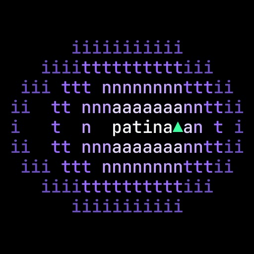
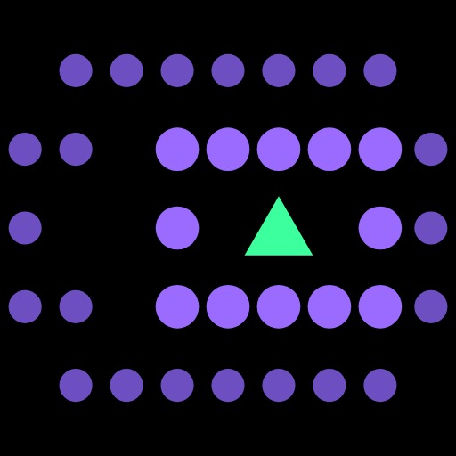
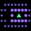
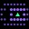
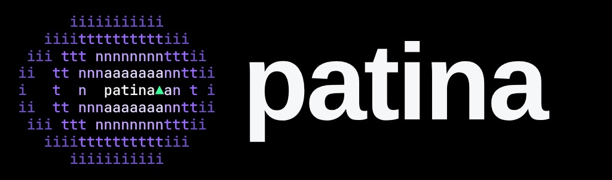
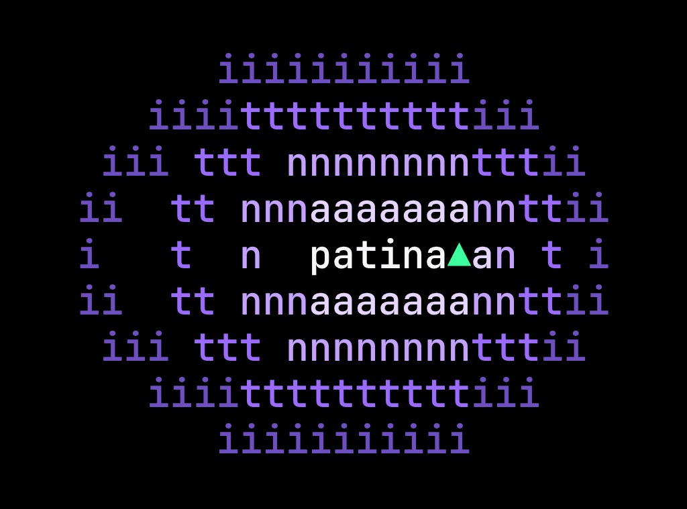
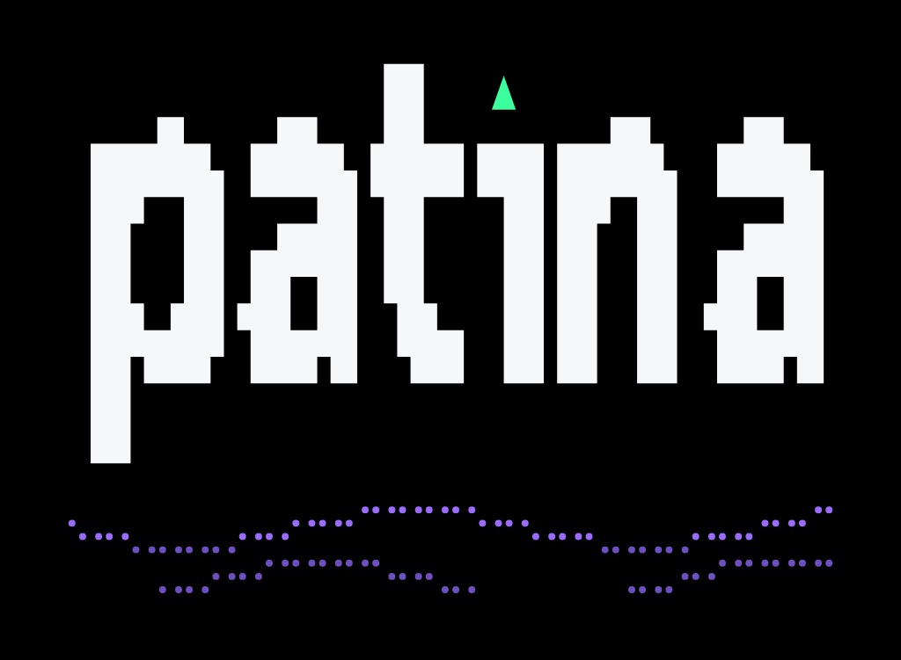

# branding/export/

Every patina mark as a picture, for places that take neither SVG nor its fonts: a web
page, a slide, a sticker, a chat avatar, a press article. Each comes as a transparent
PNG and as a JPG on aurora's black `#000000`; the PNGs show on a dark ground only, since
the marks are made for one (white letters). The previews below are the JPGs. How the
marks are made and when to use which: [`../README.md`](../README.md).

All of them are GPL-3.0-or-later like the rest of the repository.

## icon.svg, the mark as a large icon

The characters of `logo.txt` set in a square, for 96 px and up.

| Size | Transparent | On black |
|---|---|---|
| 512 × 512 | [icon-512.png](icon-512.png) | [icon-dark-512.jpg](icon-dark-512.jpg) |
| 1024 × 1024 | [icon-1024.png](icon-1024.png) | [icon-dark-1024.jpg](icon-dark-1024.jpg) |
| 2048 × 2048 | [icon-2048.png](icon-2048.png) | [icon-dark-2048.jpg](icon-dark-2048.jpg) |
| any | [../icon.svg](../icon.svg) | |

## icon-small.svg, the mark as a small icon

The rings as dots around the ▲, for 80 px and below: a favicon, a window icon, an
avatar. The large sizes are for scaling down yourself.

| Size | Transparent | On black |
|---|---|---|
| 32 × 32 | [icon-small-32.png](icon-small-32.png) | [icon-small-dark-32.jpg](icon-small-dark-32.jpg) |
| 64 × 64 | [icon-small-64.png](icon-small-64.png) | [icon-small-dark-64.jpg](icon-small-dark-64.jpg) |
| 128 × 128 | [icon-small-128.png](icon-small-128.png) | [icon-small-dark-128.jpg](icon-small-dark-128.jpg) |
| 256 × 256 | [icon-small-256.png](icon-small-256.png) | [icon-small-dark-256.jpg](icon-small-dark-256.jpg) |
| 512 × 512 | [icon-small-512.png](icon-small-512.png) | [icon-small-dark-512.jpg](icon-small-dark-512.jpg) |
| 1024 × 1024 | [icon-small-1024.png](icon-small-1024.png) | [icon-small-dark-1024.jpg](icon-small-dark-1024.jpg) |
| 2048 × 2048 | [icon-small-2048.png](icon-small-2048.png) | [icon-small-dark-2048.jpg](icon-small-dark-2048.jpg) |
| any | [../icon-small.svg](../icon-small.svg) | |

## wordmark.svg, the mark beside the name

The lockup screens show: the mark in JetBrains Mono beside patina in Sora ExtraBold.

| Width | Transparent | On black |
|---|---|---|
| 512 | [wordmark-512.png](wordmark-512.png) | [wordmark-dark-512.jpg](wordmark-dark-512.jpg) |
| 1024 | [wordmark-1024.png](wordmark-1024.png) | [wordmark-dark-1024.jpg](wordmark-dark-1024.jpg) |
| 2048 | [wordmark-2048.png](wordmark-2048.png) | [wordmark-dark-2048.jpg](wordmark-dark-2048.jpg) |
| any | [../wordmark.svg](../wordmark.svg) | |

## logo.txt, the mark in text

The mark as the terminal shows it (fastfetch, the console), in `print_logo`'s colours
on a terminal cell twice as tall as wide.

| Width | Transparent | On black |
|---|---|---|
| 512 | [logo-512.png](logo-512.png) | [logo-dark-512.jpg](logo-dark-512.jpg) |
| 1024 | [logo-1024.png](logo-1024.png) | [logo-dark-1024.jpg](logo-dark-1024.jpg) |
| 2048 | [logo-2048.png](logo-2048.png) | [logo-dark-2048.jpg](logo-dark-2048.jpg) |
| text | [../logo.txt](../logo.txt) | |

## wordmark.txt, the name in block letters

The name as `patina help` prints it, outlined: every block a rectangle, every braille
dot a circle, so it needs no font. The on-black files keep the margin of
`wordmark-blocks-dark.svg`, so they are a little taller than the transparent ones.

| Width | Transparent | On black |
|---|---|---|
| 512 | [wordmark-blocks-512.png](wordmark-blocks-512.png) | [wordmark-blocks-dark-512.jpg](wordmark-blocks-dark-512.jpg), [.png](wordmark-blocks-dark-512.png) |
| 1024 | [wordmark-blocks-1024.png](wordmark-blocks-1024.png) | [wordmark-blocks-dark-1024.jpg](wordmark-blocks-dark-1024.jpg), [.png](wordmark-blocks-dark-1024.png) |
| 2048 | [wordmark-blocks-2048.png](wordmark-blocks-2048.png) | [wordmark-blocks-dark-2048.jpg](wordmark-blocks-dark-2048.jpg), [.png](wordmark-blocks-dark-2048.png) |
| any | [wordmark-blocks.svg](wordmark-blocks.svg) | [wordmark-blocks-dark.svg](wordmark-blocks-dark.svg) |
| text | [../wordmark.txt](../wordmark.txt) | |

## Drawing them again

They are derived from the files one level up and drawn again when one of those
changes, like the outlined SVGs (the script is not part of the repository): the
SVGs and `logo.txt` set in a browser with JetBrains Mono and Sora, `logo.txt` in
`print_logo`'s colours at 20 px on a 24 px line, each screenshotted at its width, as a
PNG without background and as a JPG (quality 92) on `#000000`.
